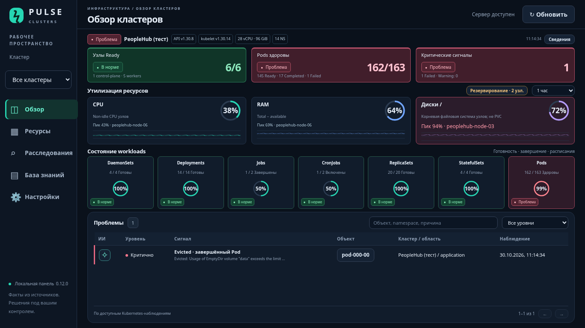

# Pulse Clusters 0.14.5

Самостоятельная панель наблюдения за Kubernetes: несколько кластеров, 22 типа ресурсов, метрики Prometheus/VictoriaMetrics, логи Kubernetes и адаптер логов Astra, контекстные вопросы локальной LLM, документы с полнотекстовым поиском, история расследований и подтверждённые решения.

**Начните с [пошаговой инструкции для вашего сервера](START-HERE-RU.md).** [Полная установка и эксплуатация](docs/INSTALL-RU.md). [Подключить кластер и проверить работу](docs/CONNECT-CLUSTER-RU.md) · [Проверки выпуска](docs/QA-RU.md) · [Контракты интеграций](docs/CONNECTORS-RU.md).

Работа с Codex: [краткий контекст проекта](docs/CODEX-STATE-RU.md) · [экономный порядок работы и шаблон задачи](docs/CODEX-WORKFLOW-RU.md). Правила для агента находятся в корневом `AGENTS.md`.

[Команды для изучения кластера и выбора показателей Pulse](docs/CLUSTER-INVENTORY-RU.md). [Разбор снимка PeopleHub 30.10.2026](docs/PEOPLEHUB-REVIEW-2026-10-30-RU.md).

## Понятный анализ и продолжение диалога — 0.14.5

Краткая таблица, отдельные режимы анализа и свободные уточнения в текущем диалоге. Ответ модели показан первым; сводка Pulse и журнал источников раскрываются отдельно. Ограничения данных остаются видимы, HTML модели не исполняется. Формат рабочего SSE Astra проверен воспроизведением присланного потока; серверный 403 требует проверки авторизации.

[Обновление 0.14.5](docs/UPDATE-0.14.5-RU.md) · [Подключение ИИ/Astra/дашбордов](docs/AI-ASTRA-DASHBOARDS-RU.md).

## Свежие диалоги и подключение Astra — 0.14.4

Повторный вход в чат открывает пустую сессию; временные диалоги не получают автоматически решения прежних инцидентов. Для последствий есть отдельная сводка проверенных фактов при отказе ИИ. Сохранённые настройки логов Astra читаются обратно без токена.

[Обновление 0.14.4](docs/UPDATE-0.14.4-RU.md) · [ИИ, Astra, знания и дашборды](docs/AI-ASTRA-DASHBOARDS-RU.md). Реальный контракт логов Astra ещё требует проверки.

## Проверка развёртывания 0.14.3

Исправлены права HTTPS-конфигурации после восстановления, проверка резервной копии до замены runtime, заполнение пустых настроек базы знаний, проверка точного тега/digest embeddings, конкурентное сохранение источников и повторная генерация Holmes после сбоя записи. В журнале ИИ недоступные и неполные проверки обозначаются отдельно.

[Применить 0.14.3 и проверить установку](docs/UPDATE-0.14.3-RU.md) · [Результаты аудита и проверок](docs/QA-RU.md).

## Надёжность метрик и анализа 0.14.2

Проверка свежести исходных метрик и соответствия узлам при каждом обновлении Обзора; защита настроек от параллельной перезаписи; ограниченный, валидный контекст ИИ и явные статусы неполных доказательств/ответов; ошибки Qdrant не считаются успешным поиском или индексацией. Проверки: полный pytest, реальный PromQL и браузерные сценарии на Docker-стенде.

[Обновить с сохранением runtime и проверить свою установку](docs/UPDATE-0.14.2-RU.md). Результаты стенда и границы проверки — в [QA](docs/QA-RU.md).

## Исправление анализа 0.14.1

Адресное исправление Astra AI HTTP 401: пояснение авторизации, сохранение проверенных фактов при отказе, явный повтор через локальную модель и проверка пропущенной причины EmptyDir. [Обновление и проверка конкретной ошибки](docs/UPDATE-0.14.1-RU.md).

## Исправления 0.14.0

Полный живой список Pods/Nodes в чате без генерации фактов моделью; валидный компактный контекст вместо обрезанного JSON. Подключение метрик проверяет CPU/RAM/диски и соответствие всем узлам до сохранения. Точная сборка видна в /healthz, интерфейсе и RELEASE.json; `./pulse check` проверяет её, `./pulse doctor --cluster peoplehub` проверяет реальные метрики.

[Применить исправление к вашей 0.13.0](docs/UPDATE-0.14.0-RU.md).

## ИИ и переносимый Docker-комплект 0.13.0

✧ открывает временный диалог без записи в историю; отдельный чат работает напрямую с локальной LLM. Qdrant с multilingual embeddings, 1478 официальных документов Kubernetes 1.30, импорт VK Teams/SaaS, 12 сценариев read-only анализа и внутренний HTTPS-домен.

[Применить обновление](docs/UPDATE-0.13.0-RU.md) · [ИИ и база знаний](docs/AI-KNOWLEDGE-RU.md) · [pulse-clusters.plagate.ru и Docker-перенос](docs/DEPLOY-DOMAIN-RU.md).

## Обзор 0.12.0 — состояние кластера на одном экране

Паспорт кластера, три показателя здоровья, CPU/RAM/диски с пиком по узлам, семь workloads и список проблем. Нажмите на узлы, ресурс или «Сведения», чтобы открыть детали. Все значения вычисляются из подключённых источников; данные прежних снимков не вшиты в интерфейс.

[Как выглядит и что показывает новый Обзор](docs/OVERVIEW-RU.md) · [Применить обновление с сохранением настроек](docs/UPDATE-0.12.0-RU.md).



## Исправление сохранения метрик 0.11.1

Видимая проверка полей и подтверждение настроек обратным чтением API. [Быстро подключить PeopleHub без переустановки или обновить приложение](docs/UPDATE-0.11.1-RU.md).

## Анализ через ИИ Astra 0.11.0

Потоковый ответ, сохранение незавершённого текста при обрыве и отдельный зашифрованный токен. [Обновление и подключение](docs/UPDATE-0.11.0-RU.md).

## Расследование с доказательствами 0.10.0

Автоматические read-only проверки выбранного Pod и журнал E01…, меню анализа с «Нужными командами», подсчёт здоровых Pod относительно всех и подключение Prometheus ClusterIP через Kubernetes API. [Обновиться с 0.8/0.9](docs/UPDATE-0.10.0-RU.md) · [Команды по PeopleHub Evicted Pod](docs/PEOPLEHUB-INVESTIGATION-RU.md) · [Изучить API ИИ Astra](docs/ASTRA-AI-RU.md).

ИИ Astra подключается отдельным провайдером по наблюдённому chat/completions API: [настройка, SSE и проверка](docs/UPDATE-0.11.0-RU.md). Нужен действительный Bearer credential; живая частная Astra здесь не проверена. Можно выбрать локальную LLM, Holmes или ИИ Astra.

## Компактный Обзор 0.9.0

Три верхние карточки, CPU/RAM/диски, семь workloads в ряд; список проблем с поиском и страницами. Круг открывает подробный dashboard, ✧ — контекстный диалог ИИ. [Изменения и обновление с сохранением данных](docs/UPDATE-0.9.0-RU.md). [HolmesGPT и приёмка read-only tools](docs/HOLMES-RU.md).

## Pulse Dark: оценка состояния с первого взгляда

Выпуск 0.8.0: узлы Ready 6/6 или 5/6 с цветом, готовность активных Pod, критические сигналы, детализация узлов и причины проблем. [Что изменилось и как обновиться с сохранением данных](docs/UPDATE-0.8.0-RU.md).

## Варианты оформления для выбора

[Четыре визуальных исполнения D+B с круговыми индикаторами: Dark / Light / Control Room / Focus](design/overview-styles/README.md). Картинки и автономный HTML-макет; для рабочего интерфейса выбран вариант 1.

## Новый обзор D+B

Выпуск 0.7.0: круговые индикаторы CPU/RAM/дисков, семь карточек workloads, карта кластеров, проблемы и история метрик. [Обновление установленного 0.6.1 с сохранением подключений](docs/UPDATE-0.7.0-RU.md).

## Выбор нового обзора

[Четыре макета дашборда: Headlamp / Lens + Grafana / Rancher / Pulse 360](design/overview-variants/README.md). Ранние макеты сохранены для истории решений; рабочий интерфейс описан выше.

[Подключение локальной LLM qwen и проверка расследования](docs/LLM-LOCAL-RU.md).

## Запуск с нуля

Linux, Python 3.12+, Docker Engine и Compose plugin с поддержкой `up --wait` (v2 и новее). Панель по умолчанию доступна только на localhost:8090.

```bash
git clone https://github.com/Ivan-Shkutov/new.git pulse-clusters
cd pulse-clusters
./pulse init --port 8090
./pulse start
./pulse check
cat runtime/secrets/portal-password
```

Логин `pulse`. С рабочей станции: `ssh -N -L 8090:127.0.0.1:8090 USER@SERVER`, затем открыть `http://127.0.0.1:8090`. Замените USER/SERVER реальными значениями. Пароли и kubeconfig не отправляйте в чат или Git.

В Settings добавьте reader kubeconfig; для модели — URL OpenAI-compatible `/v1` и model ID. Без подключений панель пустая: демонстрационных данных нет. Без LLM инвентарь продолжает работать.

## Что входит и где границы

- FastAPI, SQLite WAL/FTS5, зашифрованные подключения, один процесс и один административный аккаунт.
- UI без CDN и npm-сборки; фоновые снимки, ограниченная очередь LLM, продолжение завершённого расследования.
- MD/TXT/RST/PDF с текстом/DOCX, ограничение размера, поиск в общем корпусе и выбранном кластере.
- Docker, CLI init/start/stop/check/backup/restore/export-image, RBAC reader и экспорт краткосрочного kubeconfig.
- Зависимости закреплены с хешами; базовый образ закреплён digest.

Это новая реализация, а не исходники прежнего 0.5.0. Нет многопользовательского RBAC/OIDC, автоматических исправлений, AURA, PostgreSQL или Astra incidents. HolmesGPT подключается отдельно по [инструкции](docs/HOLMES-RU.md); реальный контейнер не проверен в текущей среде из-за запрета его registry. Обновление прежних установок Pulse использует backup/restore, не удаление runtime. Astra logs требует bearer token; совместимость с реальной версией сервера проверяется отдельно. LLM, модельные веса, Docker Engine и Kubernetes устанавливаются отдельно.

Документы в `docs/imported` и `docs/review` относятся к прежнему описанию 0.5.0 и не являются инструкцией для этого выпуска. Настоящий путь установки — `docs/INSTALL-RU.md`.

## Разработка и проверка

```bash
python3 -m venv .venv
.venv/bin/pip install --require-hashes -r requirements.txt
.venv/bin/pip install pytest==8.3.5 playwright==1.51.0
.venv/bin/python -m pytest -q
./pulse init
./pulse dev
```

В другом терминале, с установленным Chromium:

```bash
.venv/bin/python scripts/ui-smoke.py --base-url http://127.0.0.1:8090 --password-file runtime/secrets/portal-password --chromium /usr/bin/chromium
```

Browser smoke предназначен только для тестовой установки: временно меняет настройки модели и удаляет свой тестовый документ. Проверки внешних API используют контролируемые ответы и не доказывают доступ к вашей инфраструктуре.
