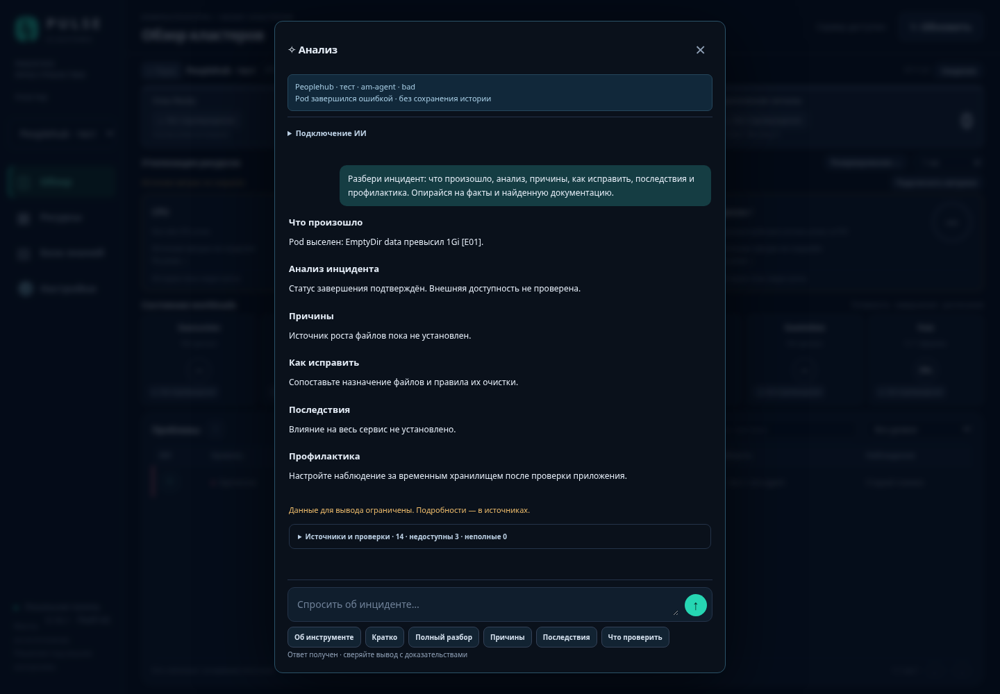

# Pulse Clusters 0.16.1

Локальная панель Kubernetes и помощник расследования инцидентов. Кнопка ✧ в Обзоре открывает временный диалог: проверенные данные кластера, поиск документации, ответ выбранной модели и раскрываемые источники. Новый вход открывает пустую переписку.

**Готовое обновление:** [порядок установки с резервной копией, тем же runtime и откатом](docs/UPDATE-0.16.1-RU.md). Complete-архив и SHA256 находятся в [releases](releases/). В архив входит готовый Docker-образ Pulse Linux amd64; веса Qwen и сторонние образы загружаются отдельно.

## Что делает приложение

- Собирает Kubernetes через API с минимальными правами чтения, различает Running/Ready/Completed, старые снимки, ошибки и неполные выборки.
- Показывает ресурсы, проблемы, CPU/RAM/диски и историю при доступном Prometheus/VictoriaMetrics.
- Привязывает расследование к cluster/namespace/name/UID. Завершённый Pod не подменяется новой репликой.
- Перед генерацией читает доказательства и ищет документацию в SQLite FTS и Qdrant. Документы D## объясняют поведение; факты E## подтверждают состояние.
- Поддерживает прямой OpenAI-compatible vLLM, наблюдавшийся SSE API Astra AI и проверенный API-контракт HolmesGPT. Провайдер выбирается явно, скрытого переключения нет.
- Основной ответ — законченный текст; совместимый старый API шести JSON-сценариев сохранён для старых клиентов.
- Не исполняет исправляющие команды модели. Предлагает условный план с проверкой результата и откатом.

## Модель и Holmes

Настройки локальной модели: базовый URL `http://127.0.0.1:8002/v1`, alias из `/v1/models`, например `qwen`. Pulse использует host network Linux; у отдельного bridge-контейнера loopback указывает на сам контейнер. Успешный 2+2 проверяет только короткую генерацию, не настоящий запрос инцидента.

Новые начальные бюджеты:

| Режим | Предел генерации | Ожидание |
|---|---:|---:|
| Прямой vLLM | 8192 токена | 300 секунд |
| Holmes, один запрос к модели | 4096 токенов | 180 секунд |
| Holmes, расследование | до 8 итераций | Pulse ожидает до 600 секунд |

Поля настраиваются и валидируются. Лимит — верхняя граница, а краткость задают правила. Он не меняет контекст модели, GPU memory utilization и ресурсы двух A30. Неверный finish_reason, пустой ответ, reasoning без финального content и сетевой отказ не выдаются за успех. Причина ошибки видна в диалоге, время/usage при наличии — в trace.

[Настройка Holmes, CPU embeddings, Qdrant и автоматического импорта](docs/AI-STACK-RU.md). Для уже сгенерированного bundle доступно обновление skills/лимитов без ротации ключей и с приватной копией; затем требуется перезапуск Holmes и настоящий тест tools. Наличие модели и reasoning parser не доказывает tool calling.

## База знаний

`deploy/compose.ai.yaml` запускает Qdrant, CPU Ollama embeddings и опциональный watcher. Его можно объединить с сгенерированным Compose Holmes в один проект. vLLM и Pulse сохраняют свои Compose.

Папка продукта содержит `manifest.json` с product/version/source/language/cluster_id и ZIP/TAR.GZ/MD. Индексируются только Markdown; остальные форматы пропускаются. Индексатор ничего не извлекает и не исполняет, проверяет пути/ссылки/размеры, публикует через Pulse и показывает отчёт в Базе знаний. Повторные неизменённые документы не пересчитывают embeddings. Смена модели или chunker требует переиндексации; старые векторы не выдаются за актуальные.

Для первого запуска используйте несколько известных документов. Наличие векторов не подтверждает релевантность поиска: проверьте ответ с нужным документом, версией и цитатой.

## Проверки и ограничения

[Повторный аудит и исправления](docs/AUDIT-0.16.1-RU.md) · [результаты проверки выпуска](docs/QA-RU.md).

Локальная проверка кода не подтверждает доступ к вашим Peoplehub/Astra/vLLM или качество ваших весов. После установки выполните `pulse check`, проверьте настоящий инцидент через `scripts/check-ai-integration.py`, а для Holmes — ответ и инструментальный nonce-тест. Ключи, kubeconfig, пароли, runtime и настоящие логи не коммитятся.

## Разработка

Python 3.12, один процесс FastAPI, SQLite с шифрованием настроек источников. Установка зависимостей: `pip install --require-hashes -r requirements.txt`, затем `pip install -r requirements-dev.txt`. Запуск полного набора: `python -m pytest -q`. [AGENTS.md](AGENTS.md) описывает карту кода и требования доказательности.

Изменения 0.16.0: один диалог вместо раздела Диагностика; понятные ошибки; увеличенные настраиваемые бюджеты; 16 skills/процессов в bundle Holmes; обновление bundle; Markdown importer/watcher и отчёты; lexical+vector retrieval с D##; безопасное обновление/переключение current.

Изменения 0.16.1: единый лимит контекста всех адаптеров; валидация Holmes до HTTP; один активный разбор и один ожидающий с timeout/отменой; защита operator scripts от перенаправления credentials. [Решения по десяти вопросам](docs/PROJECT-DECISIONS-RU.md) · [приёмка качества на случаях из чата](docs/ACCEPTANCE-CASES-RU.md).
