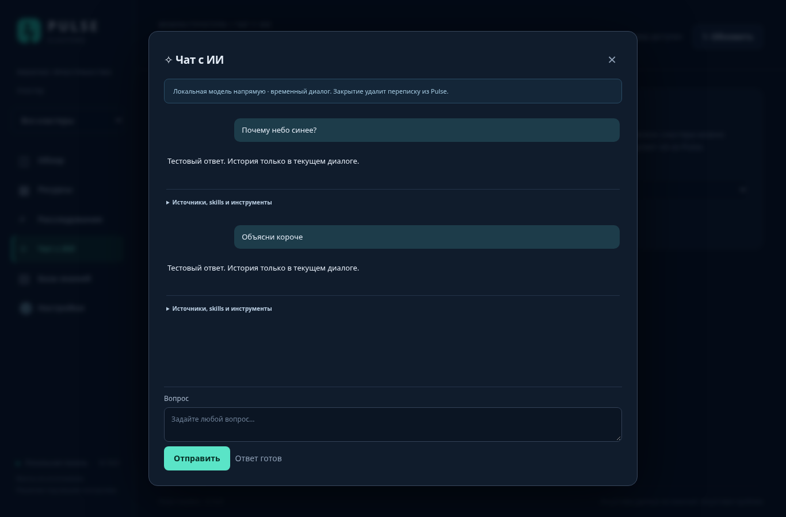
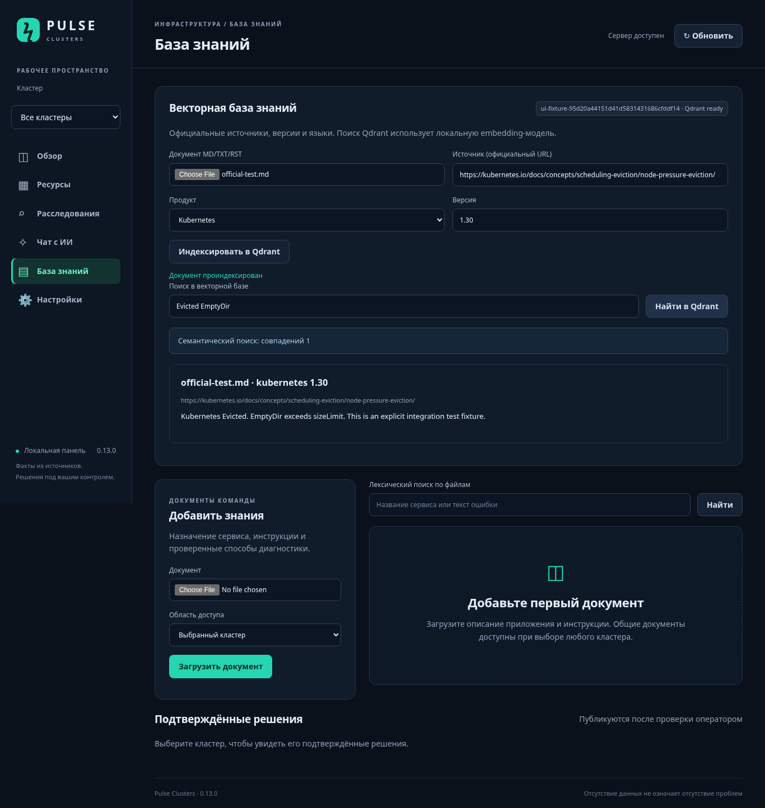

# Pulse 0.13.0: временные диалоги, локальный ИИ и Qdrant

## Что меняется

✧ в списке проблем каждый раз открывает **новый пустой диалог**. Вопросы, ответы, журнал и контекст такого диалога находятся только в памяти процесса Pulse. Закрытие крестиком/Escape удаляет диалог; поздний ответ не восстанавливает его и не попадает в SQLite. При уходе со страницы браузер отправляет удаление. Если браузер оборвался, данные удаляются через 30 минут бездействия (фоновая очистка каждые 30 секунд) либо при перезапуске. Лимит — 32 диалога, 20 сообщений в каждом.

Это относится к хранению **в Pulse**. Уже отправленный запрос может продолжить обработку на стороне Astra/LLM; их журналы и политику хранения Pulse не контролирует. Старую историю и явно созданные расследования во вкладке «Расследования» обновление не удаляет. Этот раздел по-прежнему предназначен для намеренно сохраняемых расследований.

Новая вкладка **Чат с ИИ** позволяет обсуждать любые темы. По умолчанию используется локальная модель напрямую, независимо от Astra. Можно выбрать движок кластера. При выбранном кластере доступен его снимок и документы; общие вопросы не должны трактоваться как авария кластера. Переписка также временная.



## Как получить качество без Astra AI

Для локальной модели сохраните в Настройках:

- URL `http://127.0.0.1:8002/v1`;
- Model ID `qwen`;
- API key — только если он требуется вашим сервером vLLM.

Нажмите «Проверить ответ». Для анализа по ✧ откройте настройки PeopleHub и выключите «Использовать ИИ Astra» и Holmes, если хотите нативный анализ Pulse через qwen. Для общего чата достаточно выбрать «Локальная LLM — напрямую, без Astra»; настройки кластера менять не требуется. Astra **logs** можно оставить подключёнными: чтение логов и провайдер ИИ — независимые интеграции.

Качество обеспечивается не названием ИИ, а последовательностью получения данных:

1. Pulse определяет точный объект, UID и namespace.
2. Читает Pod status/message, conditions, requests/limits, фактический узел и события UID; цепочку владельцев и заменяющие Pod; PVC; соответствующие Services/endpoints и NetworkPolicies.
3. Читает current/previous Kubernetes logs с проверкой UID; если настроено — Astra logs и историю метрик в выбранном временном окне.
4. Выполняет лексический поиск по прежним документам и семантический поиск Qdrant. Для Kubernetes использует известную minor-версию API. Переиспользованные, удалённые, не полностью индексированные и чужие документы исключаются.
5. Только после сбора формирует запрос к выбранной модели. Она получает доказательства E## и документы D## с источником, продуктом и версией. Вывод должен отделять подтверждённую причину от гипотез и перечислять пробелы.

Это ограниченный read-only сбор: до 90 секунд/55 проверок, выборки и логи ограничены по объёму. «Полный анализ всего кластера без ограничений» не обещается. Недоступные API/логи помечаются явно. Kubernetes API-запросы действительно выполняются; строки kubectl в журнале — эквиваленты, shell не запускается. Нет exec/patch/delete/drain/restart и автоматической починки. Чтение Secrets не требуется.

Локальная генерация ограничена 6000 tokens/180 сек. Ответ с `finish_reason=length` помечается незавершённым, а не успешным; его можно продолжить в этом же временном диалоге.

12 версионированных сценариев: доказательства, eviction, crashloop/OOM, images, scheduling, probes, nodes, rollout, storage, network/DNS, TLS/RBAC, VK Teams. См. `pulse_app/runbooks.py`. Нативный режим выполняет детерминированные проверки сам, без требования tool calling у модели. Holmes остаётся отдельным необязательным движком; для новых skills повторно подготовьте его bundle и выполните [живую приёмку](HOLMES-RU.md). Генерация перезаписывает bundle — сначала сохраните собственные изменения. Реальный Holmes-контейнер в этой среде не запускался.

## Запуск локальной векторной базы

В каталоге уже обновлённого проекта 0.13.0 на сервере, от root:

```bash
python3 scripts/pulse-services.py knowledge-start
python3 scripts/pulse-services.py knowledge-model
python3 scripts/pulse-services.py knowledge-check
./pulse start-offline
./pulse check
```

Команды используют `runtime` текущей установки. Если он расположен отдельно, добавляйте `--runtime /ваш/runtime` **перед** командой и используйте тот же путь у `./pulse`.

Будут запущены Qdrant на `127.0.0.1:16333` и Ollama для embeddings на `127.0.0.1:11435`. Наружу они не публикуются. Нужен доступ сервера к Docker Hub и registry модели Ollama. `knowledge-model` загружает `bge-m3`, сохраняет её фактический digest в `runtime/.env`; после этого перезапуск Pulse применяет настройки. Модель multilingual, работает на CPU и не занимает GPU вашего vLLM. Предусмотрите несколько GB свободной RAM, место для модели/индекса и длительность первичной индексации. Производительность зависит от CPU; не запускайте импорт при дефиците RAM.

Pulse, Qdrant и embeddings — отдельные контейнеры. `bge-m3` не является qwen: генерация ответа остаётся в существующем vLLM. Весов моделей в архиве приложения нет. Подтвердите размерность реальной модели первым импортом/поиском, не только наличием контейнера. Смена digest блокирует использование несовместимых embeddings; новая revision требует переиндексации. Для другого OpenAI-compatible embeddings API задайте в runtime/.env `PULSE_EMBEDDINGS_PROVIDER=openai`, URL с `/v1`, model, dimension и revision сборки модели. Ключи задаются через файлы `PULSE_EMBEDDINGS_KEY_FILE`/`PULSE_QDRANT_KEY_FILE`, доступные внутри контейнера (например `/runtime/secrets/...`). Не коммитьте credentials.

## Kubernetes: готовый официальный снимок

В образ уже включены 1478 Markdown-документов ветки `release-1.30` официального `kubernetes/website`, на английском и русском. Версия соответствует вашему API 1.30; kubelet 1.30.14 хранится отдельно. [Источник, license и границы снимка](../knowledge/README.md).

```bash
docker exec pulse-clusters-8090-pulse-1 python -m pulse_app.import_knowledge \
  --jsonl /app/knowledge/kubernetes-1.30-en-ru.jsonl.gz \
  --report /runtime/kubernetes-import-report.json
```

Импорт может занять продолжительное время. Не закрывайте команду; отчёт и статус документов покажут результат. При необходимости запускайте длительную команду в вашем штатном tmux/systemd-run. Повторный запуск обновляет те же документы, не создавая копий. Готовый документ публикуется в поиске только после всех его chunks. Если процесс был прерван, повторите импорт. При изменении minor-версии кластера подготовьте соответствующий корпус; не подменяйте его документацией другой версии.

Проверка отчёта:

```bash
python3 - <<'PY'
import json
from pathlib import Path
r=json.loads(Path('runtime/kubernetes-import-report.json').read_text())
print('Документов:',r['documents'],'Проиндексировано:',r['indexed'],'Ошибок:',len(r['failed']))
assert r['documents']==1478 and r['indexed']==1478 and not r['failed']
PY
```

В Базе знаний доступны каталог с продуктом/версией/языком, состояние индексации, просмотр полного текста, поиск и удаление. Новая форма «Индексировать в Qdrant» принимает MD/TXT/RST. Старые загрузки и их лексический FTS-поиск сохранены отдельно; автоматической миграции всех старых файлов в Qdrant нет. Для официальной выгрузки PDF/DOCX/HTML используйте импорт каталога ниже.



## VK Teams и VK Workspace

Официальные источники, указанные вами:

- `https://workspace.vk.ru/docs/on-premises/vk-teams` — серверный VK Teams;
- `https://workspace.vk.ru/docs/saas` — SaaS VK Workspace.

Версия установленного сервера пока не сообщена. Не выдавайте дату скачивания за версию продукта. Можно начать с `--version unconfirmed`, затем импортировать официальную выгрузку **вашей** версии. SaaS и on-premises индексируются разными продуктами. Инструкции SaaS не доказывают поведение on-premises.

Для публичной доступной серверу документации:

```bash
docker exec pulse-clusters-8090-pulse-1 python -m pulse_app.import_knowledge \
  --vk on-premises --version unconfirmed \
  --report /runtime/vkteams-import-report.json

docker exec pulse-clusters-8090-pulse-1 python -m pulse_app.import_knowledge \
  --vk saas --version current-saas \
  --report /runtime/vk-saas-import-report.json
```

Загрузчик делает только GET официального HTTPS-host и выбранного поддерева, без форм/логинов и переходов на другие сайты. Ограничение — 3000 страниц; failures, пропущенные non-HTML файлы или достижение лимита дают ненулевой exit code. Отчёт содержит все пропуски. Отсутствие ошибок не доказывает наличие скрытых или не связанных ссылками страниц. JS-only сайт, авторизация или отсутствие полного перевода требуют официальной выгрузки. Из облачной среды сайт VK заблокирован сетевой политикой; его фактическое содержимое здесь не скачано и не проверено.

Для предварительного просмотра можно добавить `--output /runtime/vkteams.jsonl`: это скачает текст без индексации. Проверьте, что в нём есть инструкции, а не только меню сайта. Затем импортируйте `--jsonl /runtime/vkteams.jsonl`.

Если имеется официальная выгрузка MD/TXT/RST/PDF/DOCX/HTML, передайте её на сервер, скопируйте **документы без credentials** в `runtime/data/vkteams-docs`, затем:

```bash
docker exec pulse-clusters-8090-pulse-1 python -m pulse_app.import_knowledge \
  --directory /runtime/data/vkteams-docs \
  --product vk-teams-on-premises --version unconfirmed \
  --source https://workspace.vk.ru/docs/on-premises/vk-teams \
  --report /runtime/vkteams-export-import-report.json
```

Замените `unconfirmed` подтверждённой версией. Приложение должно иметь право читать файлы каталога (UID из runtime/.env). PDF должен содержать текст; OCR не выполняется. Корпус ограничен 500 млн символов, один документ — 2 млн; крупные руководства разделите по разделам. Каждый файл сохраняет источник и версию.

## Перенос и восстановление

Штатный `./pulse backup` сохраняет каталог и полный текст документов в SQLite вместе с настройками/ключом. Индекс Qdrant и модель Ollama находятся в отдельных Docker volumes и в этот backup не входят. После восстановления на новом сервере запустите knowledge-start/model, перезапустите Pulse и восстановите индекс из каталога:

```bash
docker exec pulse-clusters-8090-pulse-1 python -m pulse_app.import_knowledge \
  --reindex --report /runtime/reindex-report.json
```

Это переиндексирует общие документы. Для документов, закреплённых за отдельным кластером, повторите с `--cluster peoplehub` и для остальных кластеров. При смене модели digest/размерности переиндексация обязательна. Переносимый [Docker-комплект](DEPLOY-DOMAIN-RU.md) описан отдельно.

## Приёмка на вашем сервере

После подключения источников и модели выполните [live-acceptance](DEPLOY-DOMAIN-RU.md). Для известной ошибки проверьте, что:

- в журнале есть фактический Pod UID, status.message, реальный nodeName, current/previous logs либо конкретная причина недоступности;
- запрос Astra logs действительно выполнен или честно указан как недоступный; наличие Astra AI не означает доступ к логам;
- Qdrant возвращает документы нужного продукта/версии со ссылками D##;
- вывод ссылается на полученные E##, не на выдуманные команды или причины;
- ответ на общую тему не превращается в диагноз кластера;
- повторное открытие ✧ пустое и не появляется новое сохранённое расследование.

Ни Qdrant, ни дополнительные prompts не гарантируют диагноз лучше Astra. Сравните обе системы на одних инцидентах и источниках; оценивайте доказательства, точность причин, пробелы и полезность команд. Приложение не меняет Kubernetes.
