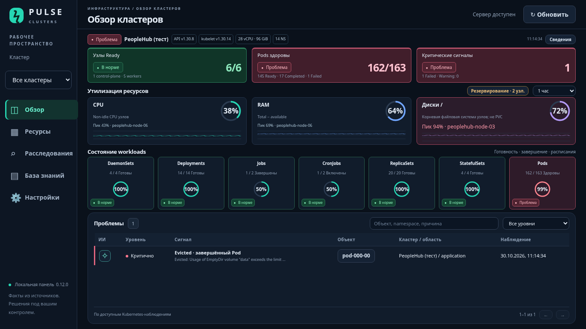
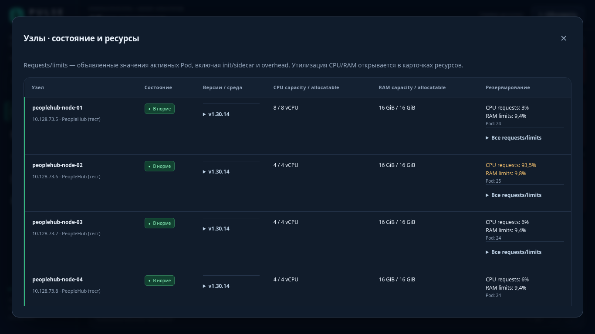

# Обзор Pulse 0.12.0

Первый экран отвечает на три вопроса: какой это кластер, что сейчас нездорово и где не хватает ресурсов. Длинные сведения открываются по нажатию. Экран проверен при масштабе браузера 100% на 1366×768 и 1920×1080; прокручивается только список проблем. На узком экране блоки переносятся и страница прокручивается.

## Что видно сразу

| Блок | Значение и действие |
| --- | --- |
| Паспорт | Kubernetes API и kubelet отдельно; суммарные CPU/RAM capacity, namespaces, время снимка. «Сведения» открывает паспорт и состояние настроек источников. |
| Узлы Ready | Готовые / все наблюдаемые узлы; состав control-plane / workers. Нажатие открывает таблицу узлов. |
| Pods здоровы | Ready + проверенные Succeeded с успешным завершением контейнеров / все Pod. Failed, Evicted и проблемы готовности подсвечиваются; Pending/завершение требуют отдельной оценки. |
| Критические сигналы | Текущие сигналы из Kubernetes. Нажатие фильтрует список проблем. Число сигналов не равно числу уникальных неисправных приложений. |
| CPU / RAM / диски | Общий процент, короткая история, пик по отдельным источникам. Круг открывает dashboard с историей и сериями. |
| Резервирование | Число узлов с CPU requests ≥90% allocatable или RAM limits >100%. Нажатие открывает таблицу узлов. |
| Workloads | DaemonSets, Deployments, Jobs, CronJobs, ReplicaSets, StatefulSets и Pods. Нажатие открывает ресурсы. |
| Проблемы | Уровень, причина, объект, namespace/кластер, время наблюдения; поиск и страницы. ✧ открывает контекстный диалог с выбранным провайдером ИИ. |

## Цвет и достоверность

- Зелёный: наблюдаемая проверка пройдена; красный: выявленная проблема; жёлтый: внимание или неполные данные.
- У метрик пороги 75% / 90%. Рамка учитывает также худший узел; кольцо показывает общий процент. «Пик» — максимум **сейчас по узлам**, не максимум за выбранный период.
- При отсутствии/устаревании данных нет фиктивного нуля или зелёного «всё исправно». Количество источников сравнивается с числом узлов; это проверка количества, не доказательство сопоставления каждого exporter с Kubernetes-узлом. Имя узла подставляется только при совпадении InternalIP с instance.
- API version получается через GET /version; kubelet version — из nodeInfo. Значения могут отличаться; интерфейс не выдаёт одну версию за другую. Старый снимок без /version покажет прочерк до следующего сбора.
- Capacity и allocatable взяты из Kubernetes. Requests/limits рассчитаны по активным Pod, включая init, restartable sidecar и overhead; завершённые Pod исключены. Неполный снимок или неподдержанный resize не выдаются за полный бюджет. Неограниченные контейнеры отмечены в деталях; сумма заданных limits не является потолком потребления узла.
- CPU — non-idle; RAM — total−available; диски — корневая ФС `/`, а не все тома/PVC. Нужен node_exporter и доступный Prometheus/VictoriaMetrics. Источник для нескольких кластеров требует cluster labels.
- Workload-круг отражает готовность, завершение Jobs или включённость CronJobs. Активный Job и намеренно остановленный CronJob сами по себе не являются аварией. Масштабированный в ноль ReplicaSet не означает неисправность.

## Таблица узлов и подробности

Для каждого узла доступны Ready/pressure, kubelet, ОС, kernel, container runtime, роли, IP, capacity/allocatable, CPU requests, RAM limits, количество активных Pod. Раскрывающиеся строки содержат conditions, taints и все requests/limits, включая число контейнеров без ограничения.

Графики, версии и числа на иллюстрациях — явно заданные **тестовые данные**, не текущий снимок PeopleHub. Рабочая панель не содержит встроенных демонстрационных значений.

[Обновить установленную версию](UPDATE-0.12.0-RU.md).
