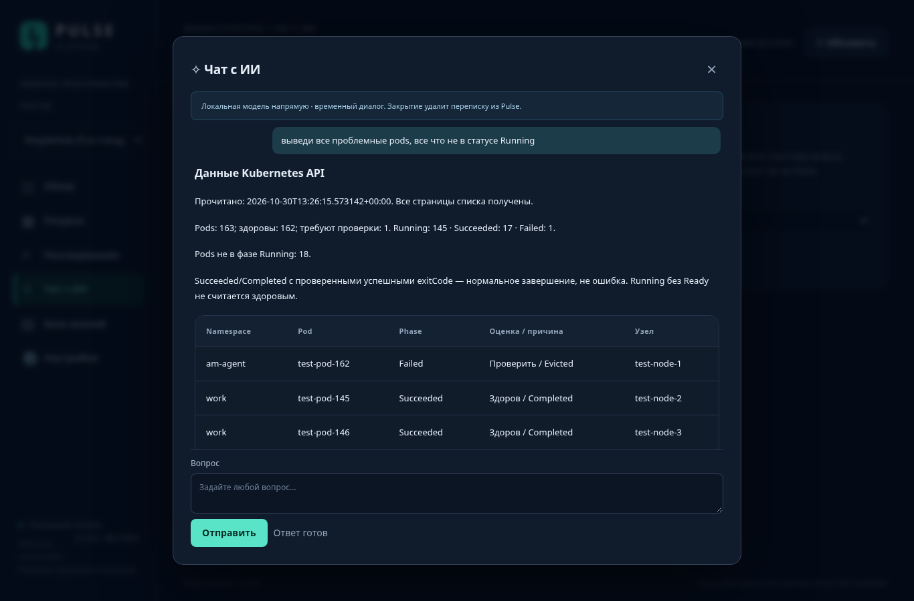
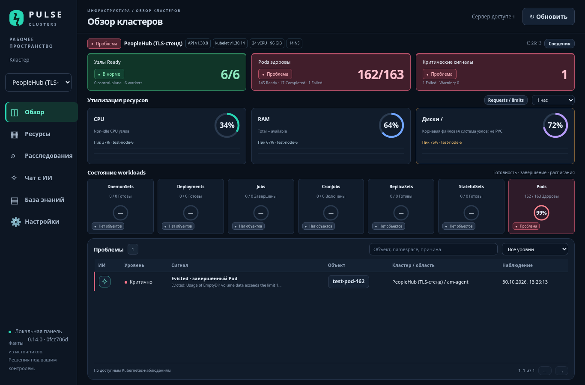

# Pulse 0.14.0 — исправить метрики и ответы чата

Точная сборка этого выпуска: **0.14.0 / 0fcc706df5925a16**. Это code build ID, вычисленный по исходникам приложения и requirements; он не равен Docker image ID. Ожидаемый ID также находится в RELEASE.json внутри архива. `./pulse --runtime runtime check` теперь отказывает, если сервер выполняет другую версию или другой код.

У пользователя подтверждена 0.13.0. На скриншоте метрики имеют состояние «источник не подключён»: это отсутствие сохранённой конфигурации, а не доказанная неисправность Prometheus. Старый чат передавал первые 15 объектов каждого типа и обрезал JSON до 24000 символов: крупные nodes могли вытеснить pods. В 0.14 JSON сначала компактно структурируется, а явные запросы списков Pods/Nodes выполняются отдельным полным read-only чтением API с пагинацией; таблица не придумывается моделью.

## Применение на сервере Pulse 10.129.160.10

Сохраните архив и SHA из приватного GitHub через авторизованный браузер. Команды ниже обновляют приложение и сразу проверяют/подключают известный Prometheus PeopleHub. Сохраняются reader kubeconfig, LLM/Astra/Holmes, документы, история и параметры Qdrant. Сам Kubernetes не переустанавливается.

Скачайте `releases/pulse-clusters-0.14.0-complete.tar.gz` и соседний `.sha256`. Передайте оба файла:

```powershell
scp "$env:USERPROFILE\Downloads\pulse-clusters-0.14.0-complete.tar.gz" dito@10.129.160.10:/home/dito/
scp "$env:USERPROFILE\Downloads\pulse-clusters-0.14.0-complete.tar.gz.sha256" dito@10.129.160.10:/home/dito/
```

На сервере от root, после передачи:

```bash
(
set -eu
umask 077
pulse_old_dir="$(docker inspect pulse-clusters-8090-pulse-1 --format '{{ index .Config.Labels "com.docker.compose.project.working_dir" }}')"
pulse_old_runtime="$(docker inspect pulse-clusters-8090-pulse-1 --format '{{range .Mounts}}{{if eq .Destination "/runtime"}}{{.Source}}{{end}}{{end}}')"
test -f "$pulse_old_dir/pulse"
test -f "$pulse_old_runtime/registry.key"
printf 'Текущая установка: %s\n' "$pulse_old_dir"
cd /home/dito
sha256sum -c pulse-clusters-0.14.0-complete.tar.gz.sha256
tar --keep-old-files -xzf pulse-clusters-0.14.0-complete.tar.gz -C /opt
cd /opt/pulse-clusters-0.14.0
sha256sum -c MANIFEST.sha256
./pulse --runtime runtime init --port 8090
./pulse --runtime runtime build
pulse_backup_dir="/root/pulse-backup-0140-$(date +%Y%m%d-%H%M%S)"
mkdir -m 700 "$pulse_backup_dir"
printf '%s\n%s\n' "$pulse_old_dir" "$pulse_old_runtime" > "$pulse_backup_dir/previous-paths.txt"
cd "$pulse_old_dir"
./pulse --runtime "$pulse_old_runtime" backup --output-dir "$pulse_backup_dir"
pulse_backup_files=("$pulse_backup_dir"/pulse-*.tar.gz)
test "${#pulse_backup_files[@]}" -eq 1
test -f "${pulse_backup_files[0]}"
./pulse --runtime "$pulse_old_runtime" stop
cd /opt/pulse-clusters-0.14.0
./pulse --runtime runtime restore "${pulse_backup_files[0]}" --confirm-restore
./pulse --runtime runtime start-offline
./pulse --runtime runtime check
python3 scripts/configure-peoplehub-metrics.py --runtime runtime --cluster peoplehub
./pulse --runtime runtime doctor --cluster peoplehub
printf 'Backup: %s\n' "$pulse_backup_dir"
)
```

При ошибке остановитесь, не удаляйте runtime. Старый пароль и подключения восстанавливаются штатным backup/restore. Откат: остановить новую версию и запустить прежнюю с путями из backup/previous-paths.txt. Настройки ИИ Astra остаются по [инструкции 0.11.0](UPDATE-0.11.0-RU.md).


Ожидается `/healthz`: version **0.14.0**, build_id **0fcc706df5925a16**. После `./pulse doctor` нужен **PASS**, а не только Healthy у контейнера. Для CPU/RAM/disk должны быть процент и покрытие **6/6** именно ваших узлов (в текущем составе PeopleHub). В других кластерах ожидаемое число определяется живым списком nodes.

Если ранее уже распаковали 0.14.0, не запускайте распаковку повторно поверх каталога: сначала проверьте MANIFEST, затем продолжите с нужного незавершённого этапа. При ошибке helper/doctor не удаляйте данные и не повторяйте всю миграцию; исправьте указанную причину и повторите только проверку метрик ниже.

## Если проверка метрик не прошла

Команды выполняются на **сервере Pulse**, из `/opt/pulse-clusters-0.14.0`:

```bash
python3 scripts/configure-peoplehub-metrics.py --runtime runtime --cluster peoplehub
./pulse --runtime runtime doctor --cluster peoplehub
```

Helper не просто записывает конфигурацию: делает запросы CPU/RAM/root filesystem, проверяет свежесть, связывает instance с именами/IP из текущего списка Kubernetes nodes и сохраняет источник только при успешной проверке всех трёх ресурсов. Затем читает настройки обратно. Он не меняет Kubernetes и другие интеграции. В присланном ранее выводе Prometheus PeopleHub instance имеют вид 10.128.73.5:9100 … 10.128.73.10:9100 — поддерживается именно такое сопоставление. Это историческое подтверждение адресов, не наша живая проверка вашего сервера.

- **HTTP 403 services/proxy**: reader может читать nodes/pods, но ему не разрешён доступ через API proxy к Prometheus. На управляющем узле PeopleHub **10.128.73.5**, под вашим RBAC-администратором, примените [metrics-proxy-peoplehub.yaml](../deploy/metrics-proxy-peoplehub.yaml). Передайте этот файл обычным SFTP/SCP или сохраните Download raw file из приватного GitHub. Затем:

```bash
kubectl apply -f /root/metrics-proxy-peoplehub.yaml
kubectl auth can-i get services/http:kube-prom-kube-prometheus-prometheus:9090 \
  --subresource=proxy -n monitoring \
  --as=system:serviceaccount:pulse-observer:pulse-reader
```

Ожидается yes. Role даёт только GET одного proxy-ресурса в monitoring. Не нужны cluster-admin для Pulse, чтение Secrets, pods/exec или широкое nodes/proxy. Если reader у вас другой, адаптируйте subject перед применением. После этого повторите helper и doctor на сервере Pulse.

- **401**: проверьте срок reader token; переподключите свежий read-only kubeconfig по [CONNECT-CLUSTER-RU](CONNECT-CLUSTER-RU.md). Одноразовый 24-часовой токен не является бессрочным доступом.
- **404**: проверьте service `monitoring/kube-prom-kube-prometheus-prometheus`, порт 9090.
- **Network/TLS**: проверьте доступ с Pulse к 10.128.73.5:6443 и доверенный CA. TLS verification не отключайте.
- **Пустые серии/missing/foreign**: проверьте node_exporter и labels. Для общего хранилища задаются cluster labels. Для вашего отдельного Prometheus используется dedicated + пустые labels. Частичный или чужой набор не выдаётся за успешное подключение.

Вместо helper доступна кнопка **«Подключить метрики»** прямо в Обзоре: выбрать найденный Prometheus, режим/labels → «Проверить и сохранить». Ошибки показываются до сохранения. После проверки страница обновит три круга. «Диагностика метрик» проверяет существующий источник без его изменения. Метрики дисков относятся к корневой ФС узлов, не ко всем PVC.

## Проверка исправленного чата

Выберите PeopleHub → Чат с ИИ → задайте буквально:

> выведи все проблемные pods, все что не в статусе Running

Pulse читает все страницы списка Pods через API, выводит время, счётчики и таблицу. Для ранее присланного состава получится 163 всего, 18 не Running: 17 проверенных Succeeded/Completed и 1 Failed/Evicted. **Эти числа не зашиты**: результат отражает реальный текущий ответ API и может измениться. Completed с успешными exitCode не объявляется неисправностью. Для «покажи нездоровые pods» Completed исключаются, но Running без Ready включаются.

Модель не вызывается для таких списков — они доступны даже без настроенной LLM. При 401/403, недочитанных страницах или ошибке сети ответ помечается неполным/ошибкой; «проблем нет» не выводится. Для вопросов с объяснением модели передаётся валидный JSON со счётчиками и проблемными объектами в начале; обрезания JSON посередине больше нет. Для расследования выбранного Pod остаётся ✧ с чтением status, событий, логов и базы знаний.





После обновления нажмите **Ctrl+F5**. Старые временные диалоги закрываются при перезапуске; новая ✧ снова пустая. Явно сохранённая история не удаляется.

Если используете Caddy из 0.13.0, перенастройте его bind на восстановленный runtime командой `python3 scripts/pulse-services.py https-start` из нового каталога; volume CA и домен сохраняются. Существующий внешний Nginx/корпоративный proxy не заменяйте.

[Отчёт проверок](QA-RU.md). В облачной среде проверен настоящий Docker Pulse и TLS-стенд Kubernetes/Prometheus с пагинацией, но прямого доступа к вашему серверу/кластерам нет. Итоговое подтверждение вашего Prometheus — успешный `./pulse doctor` на вашем сервере. Не присылайте passwords, tokens или kubeconfig; диагностический вывод их не печатает.
